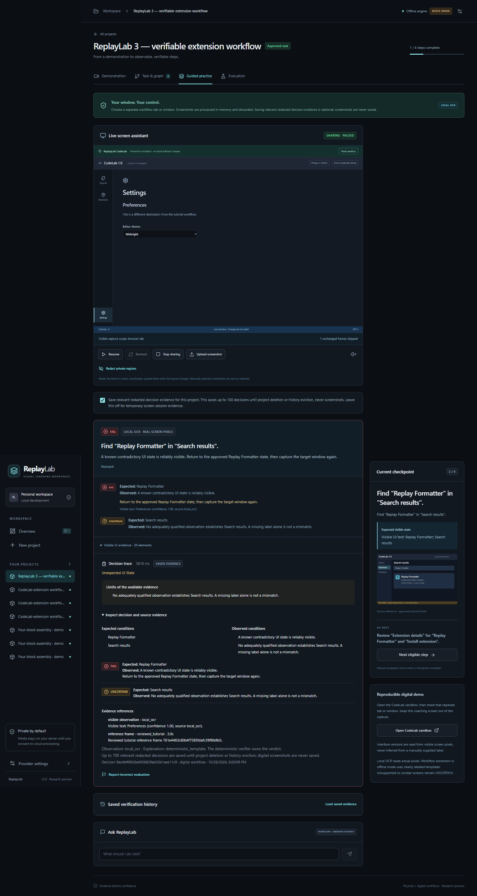

# ReplayLab 3.0

**4 November: [watch the full three-minute demonstration](ReplayLab_Meta_Hackathon_Demo.mp4)**

- **2:59.07**, one continuous recording: full tutorial playback, live Meta workflow
  generation, visible review/approval, real screen sharing, **FAIL, correction,
  PASS, UNCERTAIN**, evaluation and the completed graph.
- **Natural neural narration**, with no spoken disclaimer or dashboard introduction.
- Actual **Meta Llama 3.2 1B**, accelerated locally by AMD Vulkan. The model's
  Marketplace goal is retained; a reviewer visibly adds a known wrong destination.
  [Exact recording and audio evidence](docs/THREE_MINUTE_DEMO.md).

[Run the current setup](docs/DEMO_SETUP.md) or [read the spoken script](docs/DEMO_SCRIPT.md).
The earlier [46-second tutorial proof](docs/assets/short-tutorial-proof.mp4) is archived
with its [original measurements](docs/TUTORIAL_PROOF.md).

**Earlier prepared-workflow demonstration:** [Watch the actual uncut MP4](docs/assets/prepared-workflow-demo.mp4)
— **2:56.4, 1080p, 30 FPS**. Real shared-tab OCR and local Meta Llama inference
show **FAIL → correction → PASS → UNCERTAIN**, then measured evaluation and the
actual provider. The CodeLab target is visibly a simulation and the workflow is
prepared and reviewed before recording. The video now includes a timed synthetic voiceover, disclosed at the start.
The [original spoken script](docs/PREPARED_DEMO_SCRIPT.md) and [audio validation](docs/validation/hackathon-voiceover.json)
are included; the original video frames and timing are unchanged.

**2 November local Meta update:** ReplayLab can run **Meta Llama 3.2 3B Instruct**
on this Windows PC's CPU. Local OCR reads screenshots; Meta reasons over redacted
text, proposes reviewed digital workflows, and plans grounded explanations.
Deterministic rules retain every qualified OCR fact and decide completion.
**Built with Llama.** See [local setup and measured limits](docs/local-meta-setup.md).
The earlier [local Meta screenshot demonstration](docs/local-meta-demo.md)
(88 seconds) remains available with its original scope.

```powershell
.venv\Scripts\python.exe scripts/setup-local-meta.py --activate
npm.cmd run dev
```

The original NVIDIA Muse Glimmer adapter remains available, but its actual cloud
requests still timed out or returned HTTP 504. A different NVIDIA model responded
successfully during diagnosis; the owner requires a Meta model, so that alternative
was not selected. Local Llama is text reasoning over OCR, not Muse/SAM vision, and
hackathon eligibility remains unconfirmed. See [NVIDIA evidence](docs/nvidia-integration.md).
The original three-minute recording below remains explicitly offline.

For the current live Meta recording workflow, use the [Windows demo launcher and
recording setup](docs/DEMO_SETUP.md), [feature audit](docs/DEMO_READINESS.md),
[timed narration](docs/DEMO_SCRIPT.md), and [executed evidence](docs/DEMO_VERIFICATION.md).

```powershell
powershell -NoProfile -ExecutionPolicy Bypass -File scripts/start_demo.ps1
```

**Watch. Learn. Do.** Learn visual workflows with evidence, one reviewed checkpoint at a time.

ReplayLab supports both physical camera tasks and digital screen workflows.
Tutorials become editable steps in a shared dependency graph. After approval,
separate deterministic verifiers return **PASS**, **FAIL**, or **UNCERTAIN**, with
visible evidence and corrections. Manual navigation never marks a step complete.

Version 3 adds a common physical/digital decision record, inspectable expected
and observed conditions, explicit mismatch classifications, processing latency,
opt-in redacted digital evidence history, and incorrect-evaluation reports.
Configurable evidence gates remain deterministic; explanations cannot change a
verdict. The Evaluation page now includes captured digital screenshots alongside
the separate physical rule fixtures.

The controlled digital evaluation measured **20/20 three-class agreement**,
**0/10 false certainty**, and **10/10 uncertainty recall**, with a **2.17 s median**
and **2.93 s p95** local processing time. Labels were authored by the implementing
agent before inference, without independent human review. These small CodeLab
results do not establish broad accuracy or live Meta performance.
[Frozen cases, measured results, and reproduction](docs/digital-evaluation.md).

| Mode | Working offline example | Source of verification evidence |
| --- | --- | --- |
| Digital | Simulated CodeLab extension workflow | Actual screenshot pixels read by local RapidOCR/ONNX Runtime |
| Physical | Controlled four-block tabletop assembly | Explicit known synthetic fixture observations; arbitrary photos remain uncertain in mock mode |

The application includes real video processing, persistent projects, task editing,
graph review, camera/image capture, opt-in screen sharing, local OCR, written
coaching, optional browser speech, and grounded Ask ReplayLab answers. CodeLab is
a browser simulation: it does not install software. Neither example establishes
general workflow understanding or hidden physical/filesystem state.

Meta adapters for Muse Spark and physical SAM 3.1 remain implemented and
contract-tested. **Live Meta validation is intentionally pending**, following the
owner's instruction to finish offline. Failed live requests never become mock
results. The GitHub repository remains **private**.



[Three-minute ReplayLab 3 recording](docs/assets/v3/demo.mp4) ·
[Walkthrough, screenshots, and validation](docs/v3-demo.md) ·
[Preserved 2.0 browser validation](docs/digital-browser-qa.md)

## Quick start

Install **Node.js 22.12+**, **Python 3.11+**, and **FFmpeg** with `ffprobe` on PATH.
Python 3.12 is the tested version. From the repository root:

```powershell
# Windows PowerShell
npm.cmd run setup
npm.cmd run dev
```

```sh
# Linux
npm run setup
npm run dev
```

Open **http://127.0.0.1:5173**. API health and interactive documentation are at
http://127.0.0.1:8010/api/health and http://127.0.0.1:8010/docs. Setup creates
`.venv`, installs the locked Python dependencies and frontend packages, and does
not require environment activation. Ctrl+C stops the development services.

Setup includes `rapidocr==3.10.0`, `onnxruntime==1.31.1`, and the OCR models bundled
with RapidOCR. Screen recognition runs locally with explicit installed model
paths; it does not download models or call a cloud service while capturing.

## Try the digital workflow

1. Choose **Try digital demo**. ReplayLab generates a labeled CodeLab tutorial
   MP4, four reference screenshots, and a fixed mock task template.
2. Review **Task & graph**: expected UI states, source evidence, rules, and
   dependencies. Approve the task before verification.
3. Open the screen assistant and **Open CodeLab sandbox** in a separate tab or
   window. Choose that surface through the browser's screen/window picker.
4. In CodeLab, open Extensions, search for **Replay Formatter**, open its details,
   and use the simulated install control. Actual OCR checks the visible states;
   verified PASS results advance progress.
5. Try the Preferences pane, unexpected dialog, or different UI version to inspect
   corrections or uncertainty. Pause or stop sharing whenever needed. A manual
   screenshot upload is available when capture is unavailable.

Capture never starts silently. Its scope and preview are visible. Optional voice
uses browser `speechSynthesis`; Ask ReplayLab uses the reviewed workflow and recent
screen evidence. The app never clicks target controls, executes commands, or
installs software. See [digital workflows](docs/digital-workflows.md).

Normal observation checks changed frames every four seconds locally, or twelve
seconds in Meta mode. A bounded periodic recheck catches small UI changes that
the thumbnail filter can miss. Identical captures reuse transient results;
spoken guidance deduplicates the correction rather than OCR confidence changes.

Digital projects also accept rights-confirmed uploaded tutorials, strict YouTube
references for embedded playback, and timestamped pasted transcripts. ReplayLab
does not scrape/download YouTube videos or captions. Offline transcript extraction
uses quoted labels as candidate rules and requires manual rules where evidence is
missing. See [tutorial sources](docs/tutorial-sources.md).

## Physical workflows remain available

Choose **Explore the sample project** for the original assembly example. Watch
the actual generated video and extracted frames, review/approve its task, then
use **Guided practice** and **Load fixture**. First checkpoint passes; Blue block
to the right demonstrates an alignment mismatch; Obstructed camera view remains
uncertain. Continue with the matching second, third, and final fixtures.

Known physical fixtures are matched by decoded pixels, not filenames or requested
verdicts. Uploaded videos supply real frames, while physical mock extraction is
a fixed four-block template. Unknown camera images remain uncertain in this mode.
The verifier checks visible 2D geometry, not invisible joints or attachment.


[Original three-minute silent physical walkthrough](docs/assets/demo.mp4) ·
[Physical browser QA](docs/browser-qa.md) · [Suggested narration](docs/offline-demo-script.md)

## Privacy and providers

The default `AI_PROVIDER=mock` needs no API key. `AI_PROVIDER=nvidia` uses the
server-only `NVIDIA_API_KEY`; run `scripts/configure-nvidia.py` with the project
Python environment for hidden-input setup. Digital mock proposals and actual
local OCR are labeled separately. Physical SAM and digital Muse screenshot
observation use distinct adapters. Direct Meta Model API/SAM calls remain
unverified; the separately configured local Meta Llama route has actual responses.

Live preview masks cover selected rectangles before transmission. Local OCR
redacts detected emails and key-like text in observations and before optional
Meta screenshot requests. Redaction is best effort; choose the narrowest sharing
surface. Uploaded screenshot files do not inherit preview masks. Tutorial videos
and pasted transcripts are not automatically sanitized by screen redaction.

The application does not persist raw screen captures in project media or its
database. Sanitized screen results use bounded RAM caches, and the current project
session expires after ten minutes or is cleared on Stop. HTTP frameworks may
buffer request bodies transiently. Tutorial media, transcripts, workflows,
physical attempts, and progress remain local until project deletion.

**Save redacted verification evidence** is a separate, unchecked opt-in. It saves
up to 100 relevant decision records per workflow, never digital screenshot images
or the full OCR transcript. Explicit incorrect-evaluation reports save only the
label, redacted note, decision identifier, and timestamp. Saved evidence and
reports are removed on project deletion; changing consent affects later captures.

Cloud extraction and Meta screen processing require explicit in-app consent.
Screenshots are sent inline with `store:false` requested; uploaded tutorial files
instead request one-hour expiry plus immediate deletion. Those controls do not
guarantee zero provider retention. [Model usage](docs/model-usage.md) records the
contracts, data flow, and limits.

## Checks and deployment

```sh
npm run check       # backend tests/Ruff, frontend tests, production build
npm run contracts   # regenerate the shared OpenAPI snapshot
npm run build       # frontend production build
docker compose up --build
```

Use `npm.cmd` if PowerShell blocks `npm.ps1`. Actual results are recorded in
[test results](docs/test-results.md); captured digital evaluation is described in
[digital evaluation](docs/digital-evaluation.md), and curated physical evaluation
in [evaluation](docs/evaluation.md). Test agreement is not live model accuracy.

Docker configuration serves the application at localhost:8080 with persistent
storage when run on a working Docker engine. Container startup and public hosting
remain unverified. This is a local single-user service without public account
authentication; see [deployment](docs/deployment.md).

## Project documents

- [Architecture](docs/architecture.md), [development](docs/development.md), and [roadmap](docs/roadmap.md)
- [Digital workflows](docs/digital-workflows.md) and [tutorial sources](docs/tutorial-sources.md)
- [3.0 implementation status](docs/IMPLEMENTATION_STATUS.md), [upgrade brief](docs/replaylab-3-brief.md), and [digital evaluation](docs/digital-evaluation.md)
- [Submission checklist and remaining external requirements](docs/submission-checklist.md)
- [NVIDIA brief](docs/nvidia-upgrade-brief.md), [integration](docs/nvidia-integration.md), and [NVIDIA evaluation](docs/nvidia-evaluation.md)
- [Model usage](docs/model-usage.md), [API contracts](packages/contracts/README.md), and [test results](docs/test-results.md)
- [Original brief](docs/project-brief.md), [official-source provenance](docs/official-sources.md), [license](LICENSE), and [attribution](docs/attribution.md)

The owner authorized coding before the scheduled kickoff on 26 October 2026 and
left hackathon eligibility unconfirmed. The original physical implementation and
its recorded evidence remain preserved. Major completed updates are reviewed and
pushed to the private repository; no public-submission readiness is implied.
