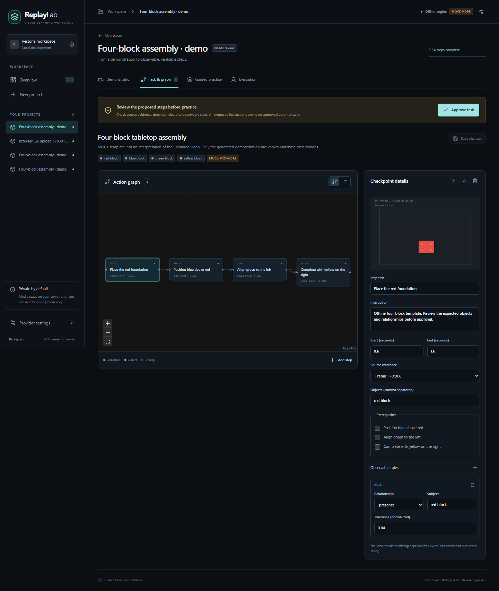

# ReplayLab

**Teach once. Learn by doing.**

ReplayLab turns a controlled tabletop demonstration into reviewed task steps and a dependency graph, then checks practice images against approved visible requirements. Its deterministic verifier returns **PASS**, **FAIL**, or **UNCERTAIN**, with object observations, individual rule results, and corrective instructions.

The local application is implemented. Real video upload, decoding, frame extraction, persistence, task editing, graph navigation, webcam capture, checkpoint uploads, and verification work together. Meta reasoning, SAM segmentation, and grounded explanation adapters are implemented and contract-tested; successful live calls remain unverified without credentials. The application makes mock provenance visible throughout.



[Watch the actual three-minute silent demonstration](docs/assets/demo.mp4) · [Browser checks and screenshots](docs/browser-qa.md) · [Suggested narration](docs/demo-script.md)

## Quick start

Install **Node.js 22.12+**, **Python 3.11+**, and **FFmpeg** including `ffprobe` on PATH. Python 3.12 is the tested version. Run these commands from the repository root.

Windows PowerShell:

```powershell
npm.cmd run setup
npm.cmd run dev
```

Linux:

```sh
npm run setup
npm run dev
```

Open **http://127.0.0.1:5173**. API health is at http://127.0.0.1:8010/api/health and interactive API documentation at http://127.0.0.1:8010/docs. Setup creates the Python virtual environment and installs locked dependencies without activation. Ctrl+C stops the development services.

## Try the offline demonstration

1. Choose **Explore the sample project**. ReplayLab generates an eight-second synthetic assembly MP4 and extracts four actual reference frames using FFmpeg.
2. Open **Demonstration** to watch the video and inspect its timeline.
3. Open **Task & graph**. Inspect the source evidence, descriptions, dependencies, and checkpoint rules; edit as needed, then **Approve task**.
4. Open **Guided practice**, choose **Load fixture**, and use **First checkpoint**. Verify it to complete the first step.
5. At the second step, try **Blue block to the right** for a visible alignment failure or **Obstructed camera view** for uncertainty. Retry with **Second checkpoint**, then complete **Third checkpoint** and **Four-block reference**.
6. Open **Evaluation** to inspect 25 labeled observation scenarios, actual predictions, and their confusion matrix.

The verifier computes its verdict from normalized observations and approved rules. Fixture images are recognized by decoded-pixel hashes; filenames and fixture buttons do not select a verdict. An unrecognized camera image or upload returns **UNCERTAIN** in mock mode.

For your own uploaded video, frame extraction is real. Mock task extraction supplies a clearly labeled four-block template rather than interpreting that video. Review and edit it; use Meta mode for actual model understanding and segmentation after live access is validated.

## Mock and Meta providers

The default is `AI_PROVIDER=mock`. Offline extraction, segmentation fixtures, and template explanations require no API key and are labeled as mock.

To configure live access, copy the example configuration:

```powershell
# Windows PowerShell
Copy-Item .env.example apps/api/.env
```

```sh
# Linux
cp .env.example apps/api/.env
```

Set `MODEL_API_KEY` in that local server file, restart the API, then select **Meta** in provider settings. Credentials stay on the server. Explicit in-app consent is required before media is sent to Meta. Authentication, billing, rate-limit, timeout, malformed-response, and outage errors stay visible; a failed live call never silently becomes a mock result.

The adapters use the documented Muse Spark `muse-spark-1.3` and SAM `sam-3.1` contracts, including Meta's official SAM parser. SAM does not establish scene completeness or camera comparability. The UI records user viewpoint/visibility attestations separately from model confidence, and missing evidence remains uncertain. See [model usage and remaining live checks](docs/model-usage.md).

## Validation and development

```sh
npm run check       # backend tests + Ruff, frontend tests + production build
npm run contracts   # regenerate packages/contracts/openapi.json
npm run build       # frontend production build
```

Use `npm.cmd` in PowerShell if script execution policy blocks `npm.ps1`. [Recorded validation](docs/test-results.md) distinguishes local checks, browser QA, fixture evaluation, and unverified external integrations. GitHub Actions runs backend/frontend checks on pushes and pull requests.

The 25-case evaluation measures deterministic behavior on curated normalized observations. Its result is not an estimate of live SAM accuracy, arbitrary task understanding, or real-world assembly performance. The MVP verifies visible 2D states in a controlled colored-block task; it cannot verify invisible physical connections.

## Deployment and data

```sh
docker compose up --build
```

With Docker running, this configuration serves the production frontend and API through http://localhost:8080 with persistent local storage. Docker image startup must be validated on a running engine; no public deployment is claimed. See [deployment instructions](docs/deployment.md).

Uploads, frames, attempts, and derived results are stored locally until the project is deleted. Project deletion also clears the shared inference cache. Generated synthetic fixtures remain available. Meta file uploads request one-hour expiration and immediate cleanup after use; a cleanup problem is disclosed. See [privacy and integration details](docs/model-usage.md). The development API is a single-user service without public account authentication; external hosting needs an authentication gateway and HTTPS.

## Project documents

- [Architecture](docs/architecture.md) and [implementation roadmap](docs/roadmap.md)
- [Development workflow](docs/development.md) and [API contracts](packages/contracts/README.md)
- [Evaluation and limitations](docs/evaluation.md)
- [Three-minute demo script](docs/demo-script.md) and [demo fixtures](demo/README.md)
- [Test results](docs/test-results.md) and [browser QA](docs/browser-qa.md)
- [Original brief](docs/project-brief.md) and [official sources/provenance](docs/official-sources.md)
- [License](LICENSE) and [third-party attribution](docs/attribution.md)

The GitHub repository remains **private** per the owner's instruction. Major completed updates are committed and pushed. The owner explicitly authorized coding before the scheduled kickoff, with hackathon eligibility left unconfirmed; no submission eligibility or public-submission readiness is claimed.
