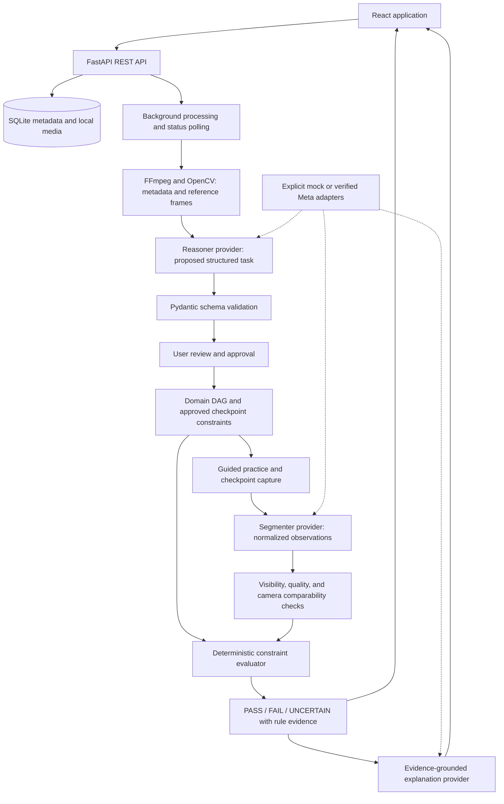

# ReplayLab architecture

**Status:** Planning only. No application, model integration, or automated test suite has been implemented or verified. Build work must begin within the official hackathon window after checking the organizer's current rules.

ReplayLab is an evidence-grounded visual task verification system: learn a small tabletop assembly from a demonstration, review the extracted instructions, then compare a learner's checkpoint image against approved observable requirements.

The MVP is a controlled four-step assembly with distinguishable colored blocks, consistent lighting, and comparable camera angles. It does not establish arbitrary assembly understanding or verify invisible connections.

## Planned system

All components above are proposed. The explanation provider receives the fixed verdict and structured evidence; it cannot change the verdict.

## Planned boundaries

| Area | Responsibility |
| --- | --- |
| `apps/web` | React, TypeScript, Vite, Tailwind CSS, React Flow, camera capture, evidence overlays, and visible provider status. |
| `apps/api/app/api` | Validated REST requests, safe media access, errors, and job status. |
| `apps/api/app/services/video` | Bounded upload inspection, frame extraction, timestamps, and processing cache. |
| `apps/api/app/services/graph` | DAG validation, topological order, dependency-aware progression, and persistence. |
| `apps/api/app/services/verification` | Normalized geometry, evidence sufficiency, rule evaluation, and verdict aggregation. |
| `apps/api/app/services/inference` | Provider orchestration, caching, validated outputs, error handling, and provenance. |
| `apps/api/app/providers` | Separate mock and Meta implementations of reasoner, segmenter, and explainer contracts. |
| `apps/api/app/database` | SQLModel or SQLAlchemy models and SQLite persistence. |
| `packages/contracts` | Shared contract definitions or generated frontend types derived from API schemas. |
| `demo` | Clearly labeled demonstration assets and evaluation fixtures with attribution. |

These paths describe a future layout; they are not claims that the directories or functionality exist. Keep graph and verification logic independent of HTTP handlers, UI rendering, and provider SDKs.

## Planned contracts and persistence

- **Structured task:** title, objects, chronological steps, dependencies, source time intervals, reference frames, observable constraints, approval state, and model/provider provenance.
- **Normalized observation:** object label, optional track identifier, normalized bounding box, optional mask, applicable quality information, timestamp, evidence source, and provider provenance. Preserve missing or unavailable quality information explicitly.
- **Verification result:** step identifier, verdict, observations, individual rule results, evidence references, explanation, and provider mode.
- **Persistent entities:** projects, videos, frames, tasks, steps, checkpoints, attempts, processing jobs, and verification results. Store media under generated identifiers with explicit deletion behavior.

Planned REST groups cover health, projects, upload/extraction, processing status, task editing, graphs, attempts, verification, evaluation, and deletion. Long-running processing returns a job identifier; the frontend polls status and shows actionable failures.

## Verification policy

Rules evaluate object presence/count, relative position, proximity/alignment, reliable color evidence, visibility, and camera comparability using normalized geometry.

| Verdict | Required evidence |
| --- | --- |
| PASS | Every required constraint is sufficiently observable and satisfied. |
| FAIL | Sufficient visible evidence establishes a specific required-constraint violation. |
| UNCERTAIN | The evidence cannot support a decision, including occlusion, low-confidence detection, poor image quality, or incompatible viewpoints. |

A missed low-confidence detection must not automatically become FAIL. Absence needs adequate scene coverage. Evidence that supports one rule must not conceal uncertainty about another. Corrections identify observed objects and the approved expected relationship; explanations must not invent observations.

## Provider modes and integration gate

- `AI_PROVIDER=mock` supports an offline demonstration with deterministic extraction and known observations for explicitly labeled fixtures. Every affected screen and result must prominently disclose MOCK MODE and provenance. Mock observations are not live segmentation or evidence of model accuracy.
- `AI_PROVIDER=meta` is planned for the brief's Muse Spark reasoning/explanation and SAM 3.1 segmentation requirements. Model availability, identifiers, endpoints, authentication, upload mechanisms, and response schemas must first be checked against current official documentation. These integrations are unimplemented and unverified.
- Keep `MODEL_API_KEY` on the backend. Handle missing credentials, billing restrictions, authentication errors, rate limits, timeouts, malformed output, unsupported input, and outages visibly. Never silently replace a failed live call with mock output.
- Without valid credentials, select and disclose mock mode. During a live session, provider errors remain explicit until the user chooses a supported recovery action.
- Cache inference with input/model/configuration provenance. Usage logs must exclude credentials and private media content.

Official references to verify before implementation: [quickstart](https://dev.meta.ai/docs/quickstart), [video understanding](https://dev.meta.ai/docs/video-understanding), [SAM overview](https://dev.meta.ai/docs/sam/overview), [SAM client libraries](https://dev.meta.ai/docs/sam/client-libraries), and [file handling](https://dev.meta.ai/docs/file-handling). These links are provided by the product brief; listing them does not certify API availability or schemas.

## Privacy, security, and delivery constraints

Validate media size, type, content, and duration; use generated filenames, bounded processing, controlled media access, configured CORS, and safe error responses. Camera capture happens only on user action. Explain cloud processing and retention before transmitting user media to an external provider. Support project/media deletion and document third-party licenses.

The GitHub repository must remain **private**, following the user's latest instruction. Commit and push meaningful completed milestones. A public-repository submission requirement, if confirmed, is a future decision requiring explicit user authorization before visibility changes. Do not commit credentials, uploads, generated media, local databases, or unreviewed inference logs.
