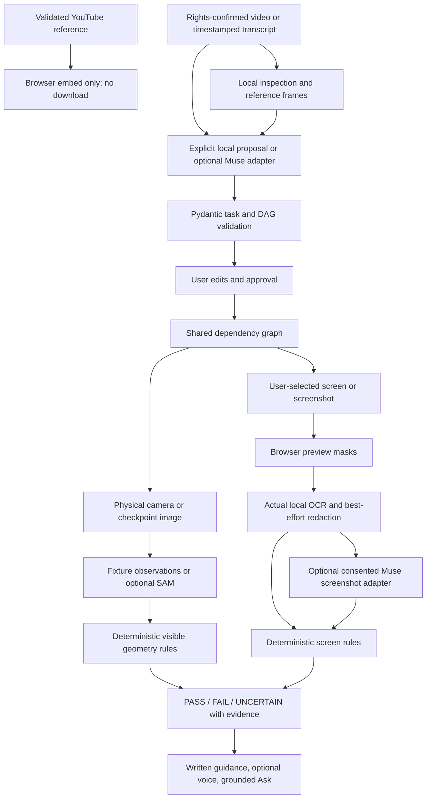

# ReplayLab architecture

ReplayLab uses a shared reviewed workflow graph with separate physical and digital
observation/verifier paths. Task modality is `physical` or `digital`; digital tasks
add expected UI states, screen rules, and optional interface version. Dependency
validation and approved progress are shared. Manual navigation does not complete a
checkpoint; only a sufficiently evidenced PASS advances it.

## Implemented flow

YouTube references provide embedded playback and user-supplied metadata. They do
not make unavailable video/caption content available to extraction. Uploaded
tutorials and pasted source content are not automatically redacted by the screen
privacy pipeline.

## Boundaries

| Location | Responsibility |
| --- | --- |
| `apps/web/src` | Both modalities, source review, graph editor, camera, `getDisplayMedia`, preview masks, coaching, optional speech |
| `main.py`, `digital_api.py` | REST, consent/approval gates, uploads, ephemeral screen sessions, cache/rate/stale-request guards, orchestration |
| `schemas.py`, `digital_schemas.py`, `api_contracts.py` | Shared workflow, physical observations, screen observations, rules, and HTTP contracts |
| `services/graph.py` | DAG validation, ordering, prerequisites |
| `services/media.py`, `tutorials.py` | Bounded local media processing, strict source references, timestamp parsing, local transcript proposals |
| `services/verification.py` | Physical normalized geometry, quality, completeness, evidence |
| `services/screen_observation.py` | Bundled RapidOCR/ONNX inference, visible text/boxes, best-effort redaction; no filesystem/application introspection |
| `services/digital_verification.py` | Positive UI evidence, contradictions, errors/dialogs, uncertainty, version/prerequisite handling |
| `providers/meta.py` | Muse physical task proposals, SAM, fixed-evidence explanation selection |
| `providers/digital_reasoner.py`, `meta_screen.py` | Muse digital proposals and separately redacted screenshot observations; screens never use SAM |
| `core/store.py` | SQLite project and physical attempt persistence |
| `services/demo.py`, `digital_demo.py` | Labeled synthetic physical and CodeLab sources |

Paths in this table are relative to `apps/api/app` unless otherwise stated.

## Evidence and progress

Physical rules evaluate presence/count, position, proximity/alignment, and
independently reliable color. Unknown confidence, poor visibility, and unsuitable
camera views remain uncertain. Missing detections prove absence only with stronger
coverage/completeness evidence. Fixtures are matched by decoded image pixels;
unknown physical images remain uncertain in mock mode.

Digital OCR reads actual pixels, including the simulated CodeLab UI. It is not
fixture lookup. Missing expected text alone cannot establish failure. Known
contradictions, qualified wrong active destinations, and visible unexpected
errors/dialogs can establish a mismatch. Explicit interface-version differences
produce uncertainty rather than invented user fault. Lexical UI evidence cannot
prove hidden settings, installed software, or on-disk files.

Tasks require review/approval. Edits reset approval/progress and invalidate stale
screen evidence. Screen Stop invalidates pending captures so late results cannot
complete a step. Cache identity includes workflow revision and relevant progress.
The app never controls target applications. Ask uses workflow/recent evidence
templates, and optional speech renders guidance without changing a verdict.

## Persistence and privacy

SQLite retains projects, source metadata/transcripts, reviewed tasks, progress,
and physical attempts. Tutorial videos, reference frames, and physical checkpoint
images stay below the ignored data directory until project deletion. Deletion
also clears shared inference caches; generated demo assets remain available.

Raw digital screenshots are transient inputs: application code does not save them
as media, database fields, or logs. Multipart middleware may buffer requests in
memory or temporary files. Current project screen evidence has a ten-minute RAM
TTL and is cleared on Stop; shared sanitized OCR/model caches are bounded and
clear on deletion/restart. Redaction is best effort and cannot guarantee that all
sensitive pixels were found. See [model usage](model-usage.md).

Background source jobs and screen caches run in one process. SQLite plus locks
supports the local single-user preview; use one API worker. Restarted jobs become
visible errors instead of silently resuming in a durable queue. Public use needs
authentication, isolation, persistent storage, and operational controls.

## Provenance and remaining external checks

The CodeLab source is a fixed synthetic mock tutorial; screen OCR is actual local
inference. Physical mock extraction remains a four-block template. Meta adapters
are implemented and tested with simulated transport, but all live validation is
pending by owner choice. A failed Meta call never selects mock observations.

The repository remains private. Early coding was explicitly authorized on
26 October 2026 with eligibility unconfirmed. [Official sources](official-sources.md)
preserve that history. [Test results](test-results.md) record actual validation;
[deployment](deployment.md) distinguishes prepared configuration from a running
public service.
