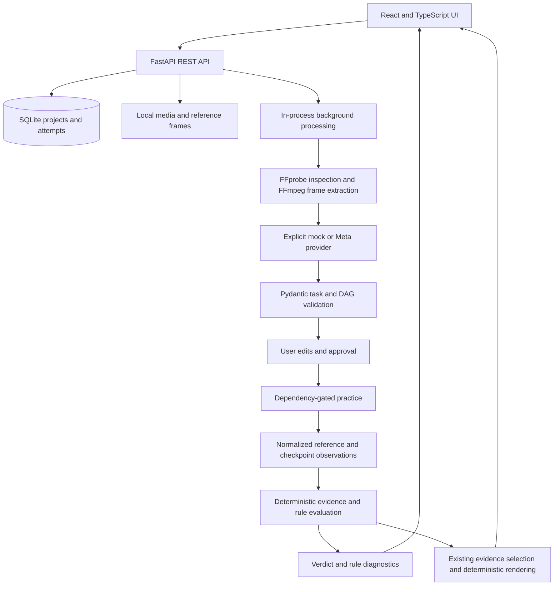

# ReplayLab architecture

ReplayLab implements a local workflow for a controlled tabletop task: process a
demonstration, review a proposed task graph, approve observable rules, capture a
checkpoint, and receive PASS, FAIL, or UNCERTAIN with rule evidence. The working
offline sample is a four-step colored-block assembly. It uses known synthetic
observations, not video understanding or live model inference.

Implementation was explicitly authorized before the scheduled kickoff on
26 October 2026. Hackathon eligibility remains unconfirmed; see
[official-source provenance](official-sources.md). The GitHub repository remains
private. Live Meta account access and a public deployment have not been verified.

## Implemented data flow

## Code boundaries

| Location | Implemented responsibility |
| --- | --- |
| `apps/web/src` | Project dashboard, video studio, editable task/React Flow graph, camera and image upload, observations, attempt history, evaluation, provider/consent controls |
| `apps/api/app/main.py` | REST routes, upload handling, consent and approval gates, background work, media access, deletion, orchestration |
| `apps/api/app/schemas.py`, `api_contracts.py` | Validated domain and HTTP payloads |
| `apps/api/app/services/media.py` | Bounded FFprobe/FFmpeg work, actual frame extraction, image decoding, pixel hashing, local MP4 preparation, measured image-quality heuristic |
| `apps/api/app/services/graph.py` | Dependency validation, cycles, topological order, available steps |
| `apps/api/app/services/verification.py` | Normalized 2D constraints, evidence sufficiency, aggregation, corrections |
| `apps/api/app/providers` | Fixed mock template/fixture observations and documented live Meta contracts |
| `apps/api/app/core/store.py` | SQLAlchemy SQLite document storage for projects and attempts |
| `apps/api/app/services/demo.py` | Synthetic images/video and registered known frame observations |
| `demo/fixtures/evaluation.json` | Curated normalized-observation scenarios used by the evaluation service |

Projects retain video metadata, frames, task/approval state, completed steps, and
processing status. Attempts retain the task revision, image, result, and reference
observations. Editing a task resets approval and progress. Verification refuses a
checkpoint from an older task revision. Only PASS advances dependency progress.

Background jobs run inside one API process and are polled by the UI. SQLite and
Python locks support the local single-user application. Interrupted jobs become
visible errors after restart; they are not automatically resumed by a durable
queue. Run one API worker.

## Evidence policy

Presence/count, above/below/left/right, proximity, alignment, and independently
observed color are supported. Positions use normalized object centers; these are
visible 2D requirements, not proof of physical attachment or hidden joints.

Both images need adequate visibility and image quality, plus established view
comparability. Missing quality/confidence stays unknown. Missing detections prove
absence only with stronger coverage and a complete-detection declaration. Exact
counts also reject ambiguous duplicate boxes. Tolerance boundaries can remain
uncertain. See [evaluation](evaluation.md) for the thresholds and measured scope.

Any sufficiently evidenced failed rule yields FAIL. PASS requires every rule to
pass. Other outcomes are UNCERTAIN, and individual uncertain rules remain visible
even when a different rule establishes failure. Explanation output cannot replace
the verdict or add unobserved facts.

## Provider and trust boundaries

Mock extraction is a fixed four-step template. Mock observations are retrieved by
hashing decoded image pixels against registered generated fixtures; filenames and
requested verdicts are not inputs. Unknown images have no fixture observations
and remain uncertain. Only frames from the app-generated demonstration are
registered as known source observations.

The Meta adapter implements documented Muse Spark and SAM calls, official mask
parsing, validated proposals, cache, cleanup, and error handling. Its transport
tests do not establish live account availability. Cloud calls require explicit
consent. SAM does not supply visibility/completeness; the API separately records
user view/visibility attestations and a local sharpness/exposure heuristic.
[Model usage](model-usage.md) explains the exact contract and limitations.

Uploads use generated server filenames and bounded decoding. Default video limits
are 100 MiB and 120 seconds; checkpoints allow 10 MiB. Media and SQLite state stay
on the server until project deletion. Deletion also clears the shared inference
cache; other projects may refill it. Generated synthetic demo data remains available. This local server has no public-user
authentication or tenant isolation. Deployment must preserve those access and
retention boundaries; see [deployment](deployment.md).

Actual check results are recorded in [test results](test-results.md).
